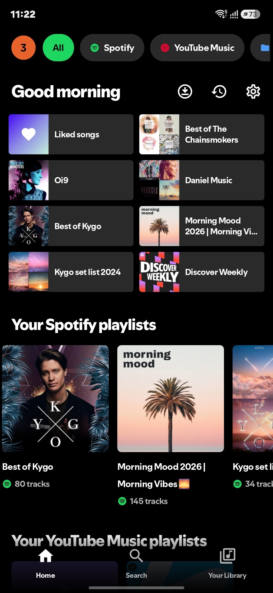
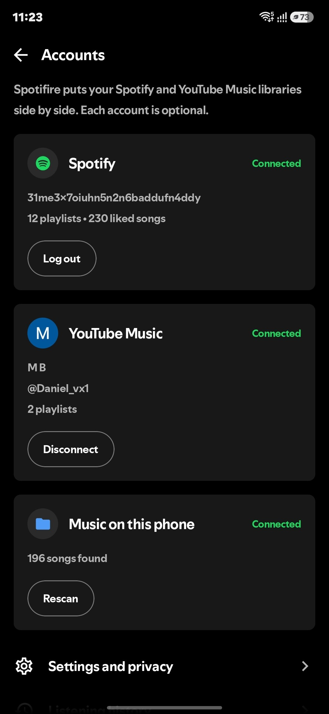

# Spotifire

**Spotify and YouTube Music in one app, with the look of Spotify, and your friends inside it.**

[-0f9d63?logo=android&logoColor=white)](https://github.com/mohamedbessaa/spotifire/releases/download/v1.1.0/spotifire-v1.1.0.apk)
[](https://github.com/mohamedbessaa/spotifire/releases/latest)
[](LICENSE)

Spotifire is a personal Android music player. It puts your Spotify library, your YouTube Music
library and the music files on your phone side by side, in an interface modeled on the Spotify app,
with offline downloads, no ads, and a Friends tab to share music and listen together.

It is built from open-source projects:

- **[Spotifeur](https://github.com/jean-voila/Spotifeur)** by jean-voila provides everything under the
  hood: Spotify sign-in and library sync, playback through Spotify's own audio engine, YouTube Music,
  the Google account, local files, downloads and offline playback.
- **Spotui**, a Jetpack Compose Spotify clone, provides the design: the Spotify-style screens were
  ported from it and rewired to Spotifeur's backend.
- **[BitChord](https://github.com/kushagrasinghx/BitChord)** provides the app icons, the settings
  layout, sound features and the update flow.

> Spotifire is a personal project. It is **not affiliated with, endorsed by or connected to Spotify,
> Google, the Spotifeur project or BitChord**. Spotify is a trademark of Spotify AB; YouTube Music is a
> trademark of Google LLC.

---

## Why Spotifire?

Spotifeur is an amazing project—its backend architecture, multi-source streaming, offline downloads, and ad-free playback are top-notch, and its UI is great. However, as a dedicated fan of Spotify's signature UI, I wanted that classic, sleek Spotify aesthetic without giving up any of Spotifeur's powerful capabilities.

**Spotifire was created specifically for Spotify UI fans.** It brings together the robust backend of Spotifeur with the authentic Spotify look and feel ported from Spotui.

---

## Preview

| Home | Search | Your Library | Accounts |
| :---: | :---: | :---: | :---: |
|  |  |  |  |
| Filter chips & quick shortcuts | Multi-source search & link import | Synced playlists & recents | Connect Spotify, YouTube & local files |

---

## Contents

- [Features](#features)
- [Friends](#friends)
- [Sound](#sound)
- [Offline listening](#offline-listening)
- [Accounts](#accounts)
- [Updates](#updates)
- [Requirements](#requirements)
- [Build and install](#build-and-install)
- [How it works](#how-it-works)
- [Privacy](#privacy)
- [Project structure](#project-structure)
- [FAQ](#faq)
- [Credits](#credits)
- [License](#license)

---

## Features

### Three sources, one library

| Source | What you get |
| --- | --- |
| **Spotify** | Your playlists, Liked Songs, saved albums and followed artists, synced both ways with your account. Search, radios, lyrics, artist pages, Canvas videos. |
| **YouTube Music** | The whole YouTube Music catalog, searchable and playable **with or without a Google account**. With a Google account: your YouTube Music playlists, which you can create, rename, edit and delete. |
| **Your phone** | The music files stored on the device, playable next to everything else. |

A small badge on each song and playlist shows where it comes from: green for Spotify, red for
YouTube Music, blue for files on the phone.

### Spotify Free, without the limits

On a Free account Spotify's engine is limited to 128 kbit/s and refuses offline listening. Spotifire
plays and downloads those songs from their best copy instead: the same recording found by its ISRC
on Monochrome (AAC 320 kbit/s or FLAC), then on YouTube Music. A copy that cannot be opened falls
back to Spotify's engine at the same position. Premium accounts keep Spotify's engine.

### Spotify-style interface

- **Pure black theme** with Spotify's green accent and typography; optional **frosted glass bars**.
- **Bottom bar** with Home, Search, Your Library and Friends, and a **mini player** tinted with the
  current cover.
- **Now Playing** with the song's **Canvas** video when it has one, or a glow made from the cover;
  shuffle, previous, play/pause, next and repeat; lyrics, queue and sleep timer.
- **Word-by-word synced lyrics** (LyricsPlus), line-synced from Spotify or LRCLIB otherwise.
- **Smart Shuffle**: recommendations mixed into the shuffled queue, marked with a sparkle.
- **Made for you** mixes and Recently played on Home.
- **App icons** to choose from in Settings.

### Things Spotify doesn't do

- **Mixed playlists** that hold Spotify songs, YouTube Music songs and local files together.
- **Playlist converter**: **⋮ → Convert to Spotify / YouTube Music**, with uncertain matches shown.
- **Import** a Spotify, YouTube or YouTube Music playlist link, or a CSV file. **Export** as CSV.
- **No Spotify account needed**: use YouTube Music and local files only, connect Spotify later.

---

## Friends

A tab of its own, everything inside the app; nothing is shared through links or other apps.

- **Add friends** by name, by `name#CODE`, or by scanning their QR code. A request needs their yes.
- **Send music**: a song, album, artist or playlist, with a note. They get a notification, then
  play it, save it or pass; you see whether it was played or saved.
- **Edit together**: a playlist every member can add to, remove from and reorder, with the avatar of
  who added each song. Changes from several phones at once, or made offline, merge into one list.
- **Blend**: 50 songs from both your tastes, new every day, made only when both of you accept.
- **Listen together (Jam)**: start from any song or playlist, invite a friend from their card, or ask
  to join what they are playing. Everyone hears the same moment of the same song: the phones stay
  together with inaudible corrections (at most 0.1%), and songs change gaplessly. Everyone can play,
  pause, skip and seek, from the app, the notification or their headphones, and the Jam shows who did
  what. Each friend gets their own queue back on leaving.
- **Profiles** with a photo (encrypted for friends), a line about you, and what you are listening to
  (off by default).
- **Recovery phrase**: 12 words that bring your friends back on a new phone (Friends settings).

Messages are end-to-end encrypted and travel over public [Nostr](https://nostr.com) relays; there is
no Spotifire server and no account to create. See [Privacy](#privacy).

---

## Sound

- **High-precision output**: every source is processed in 32-bit float and ends in a true-peak
  limiter (−0.3 dBTP), so equalizer boosts never clip, whatever the headphones or speaker.
- **Loudness**: Off, Quiet, Normal or Loud (−23/−14/−11 LUFS) with a limiter, so songs play at the
  same level whatever their source.
- **Equalizer**: bass, treble and dynamic tone, plus automatic **headphone profiles** (AutoEq).
- **Dimensional** spatial mode, and the phone's own Dolby Atmos panel where available.
- **Crossfade** and **Automix**, which blends where a song winds down.

---

## Offline listening

- **Download** a song, an album or a playlist (the ⬇ button next to the green play button), follow
  progress, pause, resume, cancel; downloads continue when the app is closed.
- **Spotify Free downloads too**, from the best copy of each song (see above).
- **Offline mode**: one switch to use no network and play only what is on the phone.
- A song in two downloaded playlists is stored once; listening cache and downloads are separate.

---

## Accounts

All accounts are optional and independent.

**Spotify** — sign in with an emailed code, with your password, or with Google for accounts linked
to Google. The session is stored encrypted with the Android Keystore. Spotifire talks to Spotify the
way the official Android app does (Login5, Playlist4, Collection, Extended Metadata); it does not use
the public Web API, a WebView player or the installed Spotify app.

**Google / YouTube Music** — avatar → **Connect Google**, then sign in on Google's page. Search and
playback of YouTube Music work without it.

**Friends** — a key made on your phone, no sign-up. Back it up with the recovery phrase.

---

## Updates

With **Automatic updates** on (Settings), Spotifire checks the [latest release](https://github.com/mohamedbessaa/spotifire/releases/latest)
on GitHub once per launch. When a newer version exists, a popup shows what's new with **Update now**
and **Later**: Update now downloads the APK inside the app and opens Android's installer; Later waits
for the next launch. With it off, nothing is checked at launch; **Check for updates** below it looks
at any time. There are no update notifications. See [docs/UPDATES.md](docs/UPDATES.md).

---

## Requirements

**Phone** — an **ARM64** Android phone with **Android 8.0 or newer**.

**Computer, to build the app**

- **JDK 21** or newer and the **Android SDK** with API **37** (Android Studio's SDK Manager).
- **Git** (on Windows, Git for Windows: part of the build runs a bash script).
- Environment variables `JAVA_HOME` and `ANDROID_HOME`.
- **The official Spotify APKM, version 9.2.0.26** (build 148373686), for Spotify's engine.

### The Spotify APKM

Spotify playback uses Spotify's own audio engine, taken unchanged from the official app. You supply
the package; it is **not** included in this repository and must never be committed.

1. Get the **APKM bundle** of Spotify **9.2.0.26** containing `arm64-v8a`.
2. Put it at `native-runtime/artifacts/spotify-9.2.0.26.apkm`.

The build checks the SHA-256 of what it extracts and stops if it differs:

```
base.apk                     cc165669d31851b1193cae7d54c9261579c431b432080970f460704d06e4612f
liborbit-jni-spotify.so      2353f26f5e174917b36c3c9de4538717c6348cc0bacf8b2c094f22d1447538e2
```

Without the APKM you can still build with `-PnativeRuntime=false`; Spotify tracks then play from
their copies only.

---

## Build and install

```sh
git clone https://github.com/mohamedbessaa/spotifire.git
cd spotifire

./gradlew :app:assembleDebug                         # with Spotify's engine (needs the APKM)
./gradlew :app:assembleDebug -PnativeRuntime=false   # without it
./gradlew :app:testDebugUnitTest                     # unit tests
```

On Windows use `.\gradlew.bat`. The APK is written to `app/build/outputs/apk/debug/app-debug.apk`;
install it with `adb install -r …` or by opening it on the phone.

**Release builds** are signed when a `keystore.properties` file sits at the repository root
(it and the keystore are ignored by Git):

```properties
storeFile=../keystore/spotifire-release.jks
keyAlias=spotifire
storePassword=…
keyPassword=…
```

`./gradlew :app:assembleRelease` then writes a signed `app-release.apk`. Published releases are
signed with the project's key: Android only updates an app signed with the same key, so a build
signed with another key must be installed after uninstalling (which erases the app's data).

Notes:

- The app installs as `app.spotifire`, next to Spotifeur or Spotify.
- With the engine included, builds are intentionally **not debuggable**: Spotify's engine is rejected
  by Android's CheckJNI, which debuggable apps enable.

---

## How it works

```
 ┌──────────────────────── Spotify-style UI (spotifire/) ────────────────────────┐
 │ Home · Search · Library · Playlist · Artist · Now Playing · Friends · ...     │
 └───────────────────────────────────┬───────────────────────────────────────────┘
                                     │ StateFlows and actions
                        SpotifeurModel + PlayerViewModel
       ┌──────────────────┬──────────┴─────────┬────────────────────┐
  Spotify (data/)   YouTube Music        Phone files         Friends (social/)
  Login5, Playlist4, (data/youtube/)     MediaStore          Nostr relays, encrypted
  metadata, ISRC    InnerTube                                messages, shared playlists
       │                  │                    │
       └──── Media3 player (playback/), two players for crossfade ───┘
             spotify:  → Spotify's native engine (Premium)
             ytm://    → best copy: Monochrome by ISRC, then YouTube Music
             file      → local file
             effects   → loudness, EQ, spatial (playback/dsp/)
```

Protocol notes for Spotify are in [`protocol/`](protocol/), especially
[`07-audio-delivery.md`](protocol/07-audio-delivery.md) and [`08-native-engine.md`](protocol/08-native-engine.md).

**Friends** uses [Nostr](https://nostr.com): every message is sealed and gift-wrapped to its
recipient (NIP-17/44/59), so relays see neither the content nor the sender. Shared playlists are
operations encrypted with a key of their own and merged the same way on every phone. Listen together
schedules playback on a common clock taken from public time servers.

---

## Privacy

- **No ads, no analytics, no crash reporting.** Diagnostics stay on the phone.
- Connections go from the phone to: Spotify; YouTube / Google; Monochrome (song copies); LRCLIB and
  LyricsPlus (lyrics); GitHub (update check, once per launch).
- **Friends**, only once you set it up:
  - Nostr relays (nos.lol, relay.primal.net, nostr.mom, relay.snort.social, offchain.pub) carry
    encrypted messages; they see your public key and when you connect, not who you talk to or what.
  - Your name and code are public **only** while *Let people find me by name* is on.
  - Your profile photo is uploaded **encrypted** to Blossom file servers (nostr.download,
    files.sovbit.host, 24242.io); only friends get the key. A small public copy exists only while
    you are discoverable.
  - *Share what I'm listening to* is off until you turn it on.
  - During Listen together the app asks public time servers (Google, Cloudflare, NTP pool) the time.
- More detail in [docs/PRIVACY.md](docs/PRIVACY.md).

---

## Project structure

| Path | Contents |
| --- | --- |
| `app/src/main/java/fr/spotifeur/spotifire/` | Spotifire's interface: `theme/`, `components/`, `screens/`, `friends/`, `SpotifireMain.kt` |
| `app/src/main/java/fr/spotifeur/social/` | Friends: identity, messages, directory, shared playlists, Blend, Jam |
| `app/src/main/java/fr/spotifeur/data/` | Spotify protocols, library, catalog, lyrics; `youtube/` for YouTube Music; `sources/` for song copies |
| `app/src/main/java/fr/spotifeur/playback/` | Player, playback service, native engine bridge, crossfade, downloads; `dsp/` for sound |
| `app/src/main/java/fr/spotifeur/update/` | Update check and download from GitHub releases |
| `app/src/main/java/fr/spotifeur/presentation/` | Spotifeur's screens still used: Settings, equalizer, history, Google sign-in, converter |
| `native-runtime/` | Bridge to Spotify's engine; `artifacts/` holds your APKM (ignored by Git) |
| `protocol/` | Documentation of Spotify's protocols |

The Kotlin package is still `fr.spotifeur`, so the code stays easy to compare with upstream Spotifeur.

---

## FAQ

More in [docs/FAQ.md](docs/FAQ.md).

**Can I download Spotify songs with a Free account?**
Yes, from the best copy of each song (Monochrome or YouTube Music), not from Spotify's engine.

**Do my friends need an account somewhere?**
No. Friends works with a key made on the phone; there is nothing to sign up for.

**I reinstalled the app and my friends are gone.**
Friends lives on the phone. Restore it with your 12 recovery words: Friends → *I use Friends on
another phone*. Write them down from Friends settings → Recovery phrase.

**Spotify songs stop after a few seconds.**
The app was built without the engine and the song has no copy. Put the APKM in place and rebuild.

**Will it run on an emulator?**
Not with Spotify's engine (ARM64 only). YouTube Music, copies, local files and Friends work.

---

## Credits

- **[Spotifeur](https://github.com/jean-voila/Spotifeur)** by jean-voila: the whole backend, playback,
  downloads, settings and protocol documentation. GPL-3.0.
- **Spotui**: the Spotify-style interface Spotifire's screens are ported from, itself building on
  Meld, [Neptune](https://github.com/navneet851/spotify-clone-jetpack-compose),
  [SpotiFLAC](https://github.com/spotbye/SpotiFLAC) and [SimpMusic](https://github.com/maxrave-dev/SimpMusic). GPL-3.0.
- **[BitChord](https://github.com/kushagrasinghx/BitChord)** by kushagrasinghx (GPL-3.0): the app icons and
  notification icon, the settings layout, the dimensional processor, the loudness limiter, the two-player
  crossfade idea, the lyrics providers' approach and the in-app update flow.
- Credited by Spotifeur: [librespot](https://github.com/librespot-org/librespot) for its public work on
  Spotify's protocols, [Resona](https://github.com/code-saksham-hash/Resona) for YouTube Music access.
- [Monochrome](https://github.com/monochrome-music/monochrome) (Apache-2.0) for exact-ISRC copies,
  [AutoEq](https://github.com/jaakkopasanen/AutoEq) (MIT) headphone profiles,
  [LyricsPlus](https://github.com/ibratabian17/YouLyPlus) word-synced lyrics, [LRCLIB](https://lrclib.net) lyrics.
- Friends: [Quartz](https://github.com/vitorpamplona/amethyst) from Amethyst (MIT) for Nostr,
  [ZXing](https://github.com/zxing/zxing) and [zxing-android-embedded](https://github.com/journeyapps/zxing-android-embedded)
  (Apache-2.0) for QR codes.
- Libraries: [AndroidX Media3](https://github.com/androidx/media), [Jetpack Compose](https://developer.android.com/compose),
  [OkHttp](https://square.github.io/okhttp/), [Coil](https://coil-kt.github.io/coil/),
  [Haze](https://github.com/chrisbanes/haze) (Apache-2.0) for the frosted bars.

## License

Spotifire is released under the [GNU General Public License v3.0](LICENSE), like Spotifeur, Spotui and
BitChord. Anyone who distributes a modified version must also publish its source under the GPL-3.0.

Not covered by this license:

- **The Spotify app package and its engine.** They are not part of this repository: you supply them,
  and they remain Spotify's property.
- **The font files in `app/src/main/res/font/spotify_mix_ui_*.otf`.** They are Spotify's typeface,
  carried over from Spotui.
- **Spotify's and Google's terms of service.** Using a third-party client with your account may break
  them, so you use Spotifire at your own risk.
