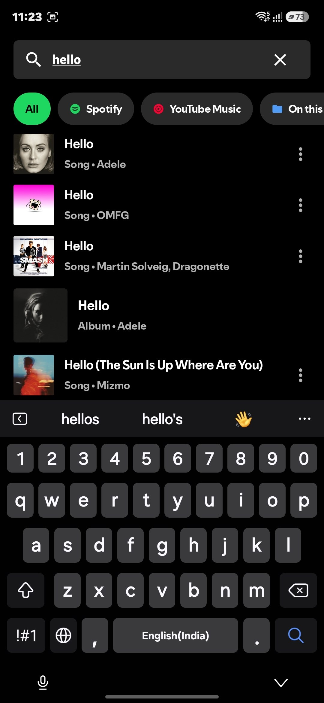
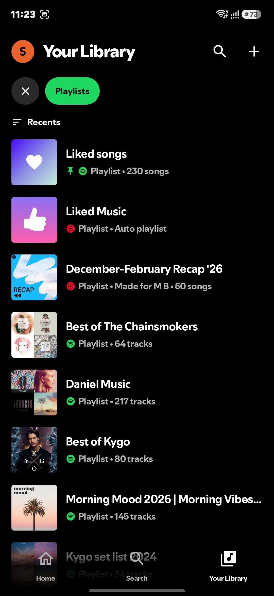

# Spotifire

**Spotify and YouTube Music in one app, with the look of Spotify.**

[-0f9d63?logo=android&logoColor=white)](https://github.com/mohamedbessaa/spotifire/releases/download/v1.0.0/spotifire-v1.0.0.apk)
[](https://github.com/mohamedbessaa/spotifire/releases/tag/v1.0.0)
[](LICENSE)

Spotifire is a personal Android music player. It puts your Spotify library, your YouTube Music
library and the music files on your phone side by side, in an interface modeled on the Spotify app,
with offline downloads and no ads.

It is built from two open-source projects:

- **[Spotifeur](https://github.com/jean-voila/Spotifeur)** by jean-voila provides everything under the
  hood: Spotify sign-in and library sync, playback through Spotify's own audio engine, YouTube Music,
  the Google account, local files, downloads and offline playback.
- **Spotui**, a Jetpack Compose Spotify clone, provides the design: the Spotify-style screens were
  ported from it and rewired to Spotifeur's backend.

> Spotifire is a personal project. It is **not affiliated with, endorsed by or connected to Spotify,
> Google or the Spotifeur project**. Spotify is a trademark of Spotify AB; YouTube Music is a trademark
> of Google LLC.

---

## Why Spotifire?

Spotifeur is an amazing project—its backend architecture, multi-source streaming, offline downloads, and ad-free playback are top-notch, and its UI is great. However, as a dedicated fan of Spotify's signature UI, I wanted that classic, sleek Spotify aesthetic without giving up any of Spotifeur's powerful capabilities.

**Spotifire was created specifically for Spotify UI fans.** It brings together the robust backend of Spotifeur with the authentic Spotify look and feel ported from Spotui.

---

## Preview

| Home | Search | Your Library | Accounts |
| :---: | :---: | :---: | :---: |
|  |  |  |  |
| Filter chips & quick shortcuts | Multi-source search & link import | Synced playlists & recents | Connect Spotify, YouTube & local files |

---

## Contents

- [Why Spotifire?](#why-spotifire)
- [Preview](#preview)
- [Features](#features)
- [Screens](#screens)
- [Offline listening](#offline-listening)
- [Accounts](#accounts)
- [Requirements](#requirements)
- [Build and install](#build-and-install)
- [First launch](#first-launch)
- [How it works](#how-it-works)
- [Privacy: no ads, no tracking](#privacy-no-ads-no-tracking)
- [Project structure](#project-structure)
- [FAQ](#faq)
- [Credits](#credits)
- [License](#license)

---

## Features

### Three sources, one library

| Source | What you get |
| --- | --- |
| **Spotify** | Your playlists, Liked Songs, saved albums and followed artists, synced both ways with your account. Full-length playback through Spotify's own audio engine. Search, radios, lyrics, artist pages. |
| **YouTube Music** | The whole YouTube Music catalog, searchable and playable **with or without a Google account**. With a Google account: your YouTube Music playlists, which you can create, rename, edit and delete. |
| **Your phone** | The music files stored on the device, playable next to everything else. |

A small badge on each song and playlist shows where it comes from: green for Spotify, red for
YouTube Music, blue for files on the phone. Spotify items, the default, carry no badge in song lists.

### Spotify-style interface

- **Pure black theme** with Spotify's green accent and Spotify-style typography.
- **Bottom bar** with Home, Search and Your Library, and a **floating mini player** tinted with the
  colors of the current cover. Swipe the mini player to change song.
- **Now Playing** screen with the cover in the middle and a **glow made from the cover's colors**
  filling the background. Below the cover you get:
  - the line of lyrics being sung
  - the title and artist, with ⊕ to save the song
  - a thin seek bar, then shuffle, previous, play/pause, next and the sleep timer
  - output device, share and queue buttons
  - a lyrics card further down
- **Synced lyrics** from Spotify, or from LRCLIB when Spotify has none. Tap a line to jump to it.
- **Queue view** with "Now playing", "Next from…", tap to jump, and remove or clear.

### Things Spotify doesn't do

- **Mixed playlists** that hold Spotify songs, YouTube Music songs and local files together.
- **Playlist converter.** A playlist's **⋮** menu has **Convert to Spotify / YouTube Music**. Matches
  appear as they are found, uncertain ones are highlighted, and you can swap or skip a song before
  the new playlist is created.
- **Import** a Spotify, YouTube or YouTube Music playlist link, or a CSV file. **Export** any playlist
  as CSV.
- **Source filters** on Home, Search and Your Library: All / Spotify / YouTube Music / On this phone
  / Mixed.
- **No Spotify account needed.** You can use the app with YouTube Music and local files only, and
  connect Spotify later.

### Everything else

- Pins, listening history, an equalizer (presets, bass boost, virtualizer), sleep timer, volume
  normalization, Google Cast for local files.
- Lock screen, notification and Bluetooth controls; playback continues in the background.
- Settings backup and restore, a diagnostic report, English and French.

---

## Screens

| Screen | What is on it |
| --- | --- |
| **Home** | Greeting, source filter chips, a 2-column grid of shortcuts (Liked Songs, pins, recent), then rows: Jump back in, Spotify playlists, YouTube Music playlists, mixed playlists, albums, artists, downloads, music on the phone. |
| **Search** | White search box, colored "Browse all" genre tiles, recent searches, results from every source as they arrive with infinite scrolling, source chips, and import from a link. |
| **Your Library** | Filter chips (Playlists, Albums, Artists, Downloaded, YouTube Music, Mixed, On this phone), sort by recents, alphabetical or creator, search inside the library, pinned items first, create or import a playlist. |
| **Playlist / Album** | Gradient from the cover's color, large cover, green play button, shuffle, save, download with a progress ring, ⋮ menu (add songs, edit, convert, delete, more). |
| **Artist** | Full-width header photo, monthly listeners, Follow, popular songs with play counts, releases (albums, singles, compilations, appears on), Fans also like, About. |
| **Now Playing** | See above. |
| **Downloads** | Storage used and free, download quality, offline mode, what is downloading (with pause, resume and cancel), downloaded albums and playlists, downloaded songs. |
| **Accounts** | Connect or disconnect Spotify and Google / YouTube Music, rescan phone music; links to Settings, history, equalizer, downloads and storage. Open it from the round avatar at the top left. |

---

## Offline listening

Download music once, play it with no connection, and it stays after the app or phone restarts.

### What you can do

- **Download** a single song (long-press it or tap **⋮**, then **Download**), a whole **album** or a
  whole **playlist** (the ⬇ button next to the green play button).
- **Follow progress**: the button turns into a ring with the percentage; the Downloads screen shows
  every download with its progress and time left; a notification shows overall progress.
- **Pause and resume all** downloads. The pause is kept even if you close the app, and downloads pick
  up where they stopped, not from zero.
- **Cancel** a download in progress.
- **Remove** a downloaded album or playlist, a **single song** (even one that came with an album, the
  rest of the album stays), or **everything** at once.
- **Choose the quality**: Normal (AAC 128 kbit/s) or Very high (up to AAC 256 kbit/s, as your
  Spotify plan allows). It applies to new downloads.
- **Offline mode**: one switch makes the app use no network at all, and play only what is on the
  phone.

### Good to know

- **No duplicates.** A song that is in two downloaded playlists is stored once.
- **Downloads and cache are separate.** Downloads are kept until you remove them. Songs you only
  listened to are kept for a while in a separate cache, whose size you set in Settings → Storage, and
  are deleted as new ones come in.
- **When you are offline**, a bar at the bottom says so, and songs that cannot play right now are faded.
- **Interrupted downloads** (no connection, app closed, phone restarted) wait and continue by
  themselves once the connection is back.

### Spotify Free vs Premium

Before downloading a Spotify song, Spotifire asks your Spotify account whether offline listening is
allowed, the same check the official app makes. **Spotify only allows it on Premium**, so:

| Account | Spotify songs | YouTube Music songs | Phone files |
| --- | --- | --- | --- |
| Spotify Premium | ✅ download | ✅ download | ✅ always offline |
| Spotify Free | ❌ skipped | ✅ download | ✅ always offline |
| No Spotify account | — | ✅ download | ✅ always offline |

On a Free account, to listen offline to a Spotify playlist, convert it to YouTube Music
(**⋮ → Convert to YouTube Music**) and download the new playlist.

---

## Accounts

Both accounts are optional and independent.

**Spotify.** You can sign in three ways:

- your email: Spotify sends you a code
- your email or username and password
- Google, for Spotify accounts linked to Google

The session is stored encrypted with the Android Keystore. Spotifire talks to Spotify the way the
official Android app does (Login5, Playlist4, Collection, Extended Metadata). It doesn't use the
public Web API, a WebView player or the installed Spotify app.

**Google / YouTube Music.** Tap the avatar → **Connect Google** and sign in on Google's own page.
Your YouTube Music playlists then appear in Your Library under the **YouTube Music** chip. Search
and playback of YouTube Music work without this account.

---

## Requirements

**Phone**

- An **ARM64** Android phone with **Android 8.0 or newer**. Almost every phone from the last six years
  qualifies. Spotify's audio engine exists for ARM64 only.

**Computer, to build the app**

- **JDK 21**: `winget install EclipseAdoptium.Temurin.21.JDK`
- **Android SDK** with Android API **37**, the latest Build-Tools and Platform-Tools. The easiest way
  to get it is Android Studio (`winget install Google.AndroidStudio` → More Actions → SDK Manager).
- **Git** (on Windows, Git for Windows: part of the build runs a bash script with its `bash.exe`).
- Environment variables `JAVA_HOME` and `ANDROID_HOME`.
- **The official Spotify APKM, version 9.2.0.26** (build 148373686), see below.

### The Spotify APKM

Spotify playback uses Spotify's own audio engine, taken unchanged from the official app. You supply
the official app package; it is **not** included in this repository and must never be committed.

1. Get the **APKM bundle** of Spotify **9.2.0.26**, the variant that contains `arm64-v8a`. Version
   and format must match exactly.
2. Put it at `native-runtime/artifacts/spotify-9.2.0.26.apkm`.

The build checks the SHA-256 of what it extracts and stops if it differs:

```
base.apk                     cc165669d31851b1193cae7d54c9261579c431b432080970f460704d06e4612f
liborbit-jni-spotify.so      2353f26f5e174917b36c3c9de4538717c6348cc0bacf8b2c094f22d1447538e2
```

Without the APKM you can still build (see below). Everything works except Spotify playback, which
stops after a few seconds.

---

## Build and install

```powershell
git clone https://github.com/mohamedbessaa/spotifire.git
cd spotifire

# Full build, with Spotify playback (needs the APKM in native-runtime/artifacts/)
.\gradlew.bat :app:assembleDebug

# Or without the APKM
.\gradlew.bat :app:assembleDebug -PnativeRuntime=false
```

On macOS or Linux, use `./gradlew` instead of `.\gradlew.bat`.

The first build downloads Gradle and the libraries (about 5–10 minutes). The APK is written to:

```
app/build/outputs/apk/debug/app-debug.apk
```

**Install it**, either way:

- **USB:** enable *Developer options → USB debugging* on the phone (tap *Build number* seven times in
  *About phone*), connect it, then run
  `adb install -r app/build/outputs/apk/debug/app-debug.apk`
- **Copy:** send the APK to the phone (cable, cloud, messaging) and open it. Allow "Install unknown
  apps" when Android asks.

Notes:

- The app installs as `app.spotifire`, so it lives **next to** Spotifeur or Spotify without replacing
  them.
- With the engine included, the debug build is intentionally **not debuggable**: Spotify's engine is
  rejected by Android's CheckJNI, which debuggable apps enable.
- **Run the unit tests** with `.\gradlew.bat :app:testDebugUnitTest`.

---

## First launch

1. Choose **Log in to Spotify with email**, **Continue with Google**, **Log in with password**, or
   **Continue without Spotify**.
2. Allow access to audio files if you want the music on your phone in the app.
3. Optional: tap the round **avatar** (top left) → **Connect Google** for your YouTube Music playlists.
4. Optional: open a playlist and tap ⬇ to keep it offline.

---

## How it works

```
 ┌───────────────────────── Spotify-style UI (spotifire/) ─────────────────────────┐
 │ Home · Search · Library · Playlist/Album · Artist · Now Playing · Downloads ... │
 └────────────────────────────────────┬────────────────────────────────────────────┘
                                      │ StateFlows and actions
                          SpotifeurModel + PlayerViewModel
          ┌───────────────────────────┼──────────────────────────────┐
     Spotify (data/)          YouTube Music (data/youtube/)     Phone files
  Login5, Playlist4,          InnerTube search, playlists,      MediaStore
  Collection, metadata        Google account (cookies)
          │                           │                              │
          └──────────── Media3 player (playback/SpotifyPlayer) ──────┘
              spotify:  → HLS through Spotify's native engine (Orbit)
              ytm://    → progressive stream (YouTubeDataSource)
              file      → local file
                      reads downloads first, then the cache, then the network
```

**Spotify audio** is delivered as encrypted HLS. Spotify's own engine processes each sample at
playback time. For offline playback, the encrypted segments and the engine's own key response are
stored, encrypted at rest with an Android Keystore key, and handed back to the engine later. The
audio is never decrypted to a file: downloaded Spotify songs only play inside Spotifire. The full
protocol notes are in [`protocol/`](protocol/), especially
[`07-audio-delivery.md`](protocol/07-audio-delivery.md), [`08-native-engine.md`](protocol/08-native-engine.md)
and [`09-offline.md`](protocol/09-offline.md).

**YouTube Music audio** is read in byte ranges through the anonymous player endpoint and stored in the
same download system.

**Downloads** use AndroidX Media3's `DownloadManager` with a persistent index, a dedicated cache that
is never evicted, a foreground service so downloads continue when the app is closed, and automatic
pause and resume when the connection drops and returns.

---

## Privacy: no ads, no tracking

- **No ads**: no ad SDKs, banners, sponsored songs or promoted content, on any screen.
- **No analytics** and no crash-reporting services. Diagnostics are recorded on the phone only. The
  diagnostic report in Settings leaves out usernames and identifiers and is shared only if you copy it
  yourself.
- **Only music**: no podcasts, audiobooks, videos or Canvas loops.
- Connections go directly from the phone to Spotify, YouTube / Google and LRCLIB (lyrics).
- **One dependency to be aware of:** Google Cast (`play-services-cast-framework`, used to cast local
  files) brings in Google's `datatransport` logging library, as every app using the Cast SDK does.
- **Update checks are turned off.** Spotifeur's built-in updater would install Spotifeur's releases,
  so Spotifire gets new versions by rebuilding from this repository.

---

## Project structure

| Path | Contents |
| --- | --- |
| `app/src/main/java/fr/spotifeur/spotifire/` | **Spotifire's interface**: `theme/` (palette, fonts), `components/` (covers, rows, pills, mini player, bottom bar), `screens/` (Home, Search, Library, collections, artist, Now Playing, Downloads, accounts and login), `SpotifireMain.kt` (navigation) |
| `app/src/main/java/fr/spotifeur/data/` | Spotify protocols, library, catalog, search, playlists, lyrics; `youtube/` for YouTube Music and the Google account |
| `app/src/main/java/fr/spotifeur/playback/` | Player, playback service, native engine bridge, audio cache, downloads (`DownloadCenter.kt`) |
| `app/src/main/java/fr/spotifeur/SpotifeurModel.kt` | The state and actions the interface uses |
| `app/src/main/java/fr/spotifeur/presentation/` | Spotifeur's own screens still used: Settings, equalizer, history, Google sign-in, playlist converter |
| `native-runtime/` | Bridge to Spotify's engine; `artifacts/` holds your APKM (ignored by Git) |
| `protocol/` | Spotifeur's documentation of the protocols |

The Kotlin package is still `fr.spotifeur`, so the code stays easy to compare with upstream Spotifeur.

---

## FAQ

**Can I download Spotify songs with a Free account?**
No. Spotify allows offline listening on Premium only, and Spotifire respects that. YouTube Music songs
and phone files work offline on any account; see [Spotify Free vs Premium](#spotify-free-vs-premium).

**Can I export downloads as MP3 files?**
No. Spotify downloads stay encrypted and play only inside the app, as in the official app.

**Spotify songs stop after a few seconds.**
The app was built without the engine: either the APKM is missing, or the build used
`-PnativeRuntime=false`. Put the APKM in place and rebuild.

**The build says the artifact differs from Spotify Android 9.2.0.26.**
The APKM is another version or variant. You need exactly 9.2.0.26, as an APKM bundle with arm64-v8a.

**Will it run on an emulator?**
Not with Spotify playback: the engine is ARM64 only. YouTube Music and local files can work.

**Is there a light theme?**
No, Spotifire is always dark, like Spotify.

**Is there a background video on Now Playing?**
No. Spotify's Canvas videos are not supported. The cover and its color glow take that place.

---

## Credits

- **[Spotifeur](https://github.com/jean-voila/Spotifeur)** by jean-voila: the whole backend, playback,
  downloads, settings and protocol documentation. GPL-3.0.
- **Spotui**: the Spotify-style interface Spotifire's screens are ported from, itself building on
  Meld, [Neptune](https://github.com/navneet851/spotify-clone-jetpack-compose),
  [SpotiFLAC](https://github.com/spotbye/SpotiFLAC) and [SimpMusic](https://github.com/maxrave-dev/SimpMusic). GPL-3.0.
- Credited by Spotifeur: [librespot](https://github.com/librespot-org/librespot) for its public work on
  Spotify's protocols, [Resona](https://github.com/code-saksham-hash/Resona) for YouTube Music catalog
  and stream access.
- Libraries: [AndroidX Media3](https://github.com/androidx/media),
  [Jetpack Compose](https://developer.android.com/compose), [OkHttp](https://square.github.io/okhttp/),
  [Coil](https://coil-kt.github.io/coil/) and [LRCLIB](https://lrclib.net) for lyrics.

## License

Spotifire is released under the [GNU General Public License v3.0](LICENSE), like Spotifeur and Spotui.
Anyone who distributes a modified version must also publish its source under the GPL-3.0.

Not covered by this license:

- **The Spotify app package and its engine.** They are not part of this repository: you supply them,
  and they remain Spotify's property.
- **The font files in `app/src/main/res/font/spotify_mix_ui_*.otf`.** They are Spotify's typeface,
  carried over from Spotui.
- **Spotify's and Google's terms of service.** Using a third-party client with your account may break
  them, so you use Spotifire at your own risk.
